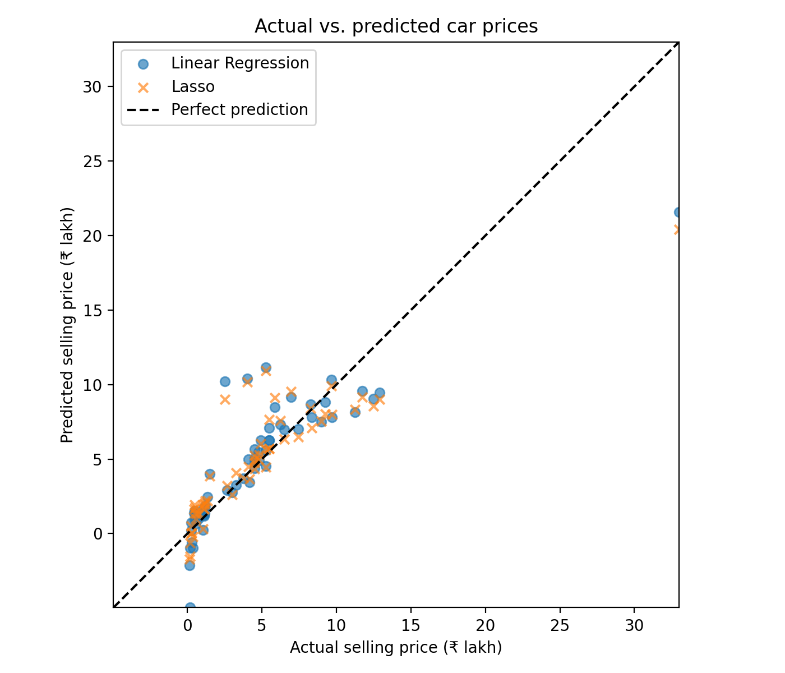
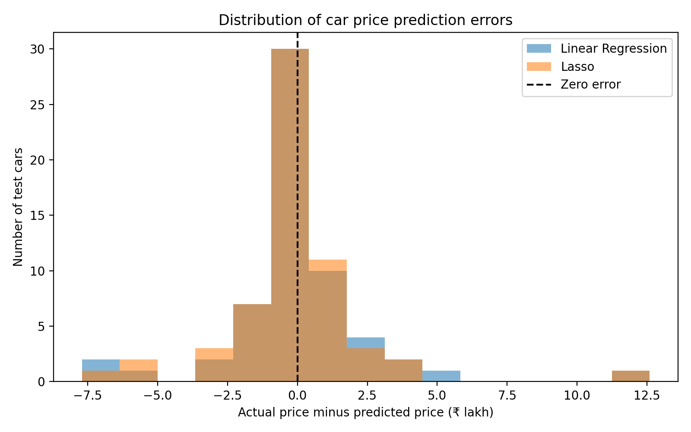

# Car Price Prediction

## Project overview

I built this project as part of the TRAINLYZE Machine Learning internship.
It estimates a vehicle’s selling price in lakh rupees using Linear Regression
and Lasso Regression. The inputs are the vehicle year, present price,
kilometres driven, number of previous owners, fuel type, seller type,
and transmission.

## Dataset and preparation

The dataset contained 301 records. After removing two duplicate rows,
I used 239 records for training and 60 for testing. I scaled the numeric
inputs and used one-hot encoding for fuel type, seller type, and transmission.

[View the original dataset on GitHub](https://github.com/RimjimRazdan/cars_price_prediction/blob/master/car%20data.csv)

## Model results

| Model | R² score | Mean absolute error (₹ lakh) |
|---|---:|---:|
| Linear Regression | 0.753 | 1.473 |
| Lasso Regression | 0.754 | 1.488 |

Linear Regression had the lower average price error on the 60 test vehicles.
Lasso had a slightly higher R² score. Both models underestimated the selling
price of the most expensive vehicle in the test set.

## Charts

## How to run the project

1. Open `Car_Price_Prediction.ipynb` in Google Colab.
2. Select **Runtime → Run all** to load the data, train both models, and view the results.
3. Change the values in the example `predict_car_price()` call to test another vehicle.
4. Enter the present price in lakh rupees and the distance driven in kilometres.

## Author

Vaibhav Gare
